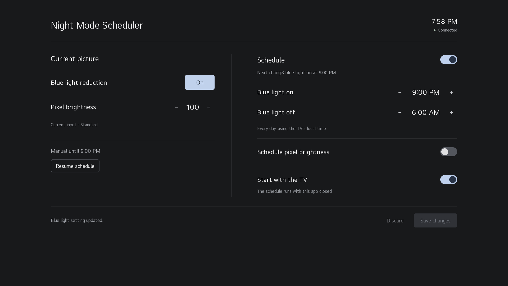

# Night Mode Scheduler

A TV app for scheduling blue light reduction on rooted LG webOS TVs, with live
status, manual controls, and optional pixel brightness scheduling.



## Features

- Blue light reduction on at **9 PM**, off at **6 AM**, with editable times.
- Uses the TV's local clock and applies the appropriate state at startup/wake.
- Live blue light, pixel brightness, input/picture mode, and startup status.
- Temporary manual changes, including changes made through LG's menus or an
  existing remote script. Resume the schedule immediately or wait for its next
  transition.
- Optional day/night pixel brightness from **0 to 100**, defaulting to **100**.
  Brightness scheduling is off by default, preserving the TV's current brightness.
- Starts at boot through Homebrew Channel and works with the app closed.
- Remote arrow/OK/Back navigation and Magic Remote pointer support.
- Local-only operation: no accounts, analytics, HTTP server, or internet dependency.

## Requirements

- A rooted LG TV running webOS 6.5.3 or newer, and Homebrew Channel with
  working root access.
- JavaScript service runtime Node.js 8 or newer. Initial development targets
  webOS 6.5.3 on an LG OLED65C1PUB. Other models/releases are not yet verified.
- The TV's `picture` settings must expose `eyeComfortMode` and `backlight`.

This is an independent homebrew utility, not an LG application. Eye Comfort
Mode is the setting used for blue light reduction on the tested TV. Support
can vary with picture modes, firmware, or model.

## Install

Download the `.ipk` from Releases and install it with webOS Dev Manager, or:

```sh
ares-install --device YOUR_TV io.github.dmilin1.nightmodescheduler_1.0.0_all.ipk
ares-launch --device YOUR_TV io.github.dmilin1.nightmodescheduler
```

Open the app once. It asks Homebrew Channel to elevate its background service
and enables startup on first launch. Subsequent launches preserve the startup
switch. Default scheduling is enabled; the app immediately applies the correct
blue light setting for the current local time.

The interface separates current picture controls from the daily schedule.
Optional day/night brightness controls expand only when enabled.

## Behavior

The service checks every 10 seconds, so scheduled changes occur within about
10 seconds while the TV is running. It retries after temporary settings-service
failures. It never wakes the TV to perform a change. After a cold boot or a
detected long pause, it catches up to the current schedule.

Manual settings override the schedule until its next boundary. They are stored
across service restarts, but expire at the transition. Saving the schedule or
choosing **Resume schedule** clears the override. If the schedule is paused,
manual controls still work and no scheduled changes are applied.

Brightness is scoped by the TV to the current input/picture mode; this app does
not rewrite every profile. With brightness scheduling off, the service does not
write brightness unless you use **Adjust now**. With it on, a detected input or
picture-mode change applies the active scheduled brightness to the new context.

## Build and preview

Requires Node.js 20+ and Python 3 on your development computer. The TV service
itself uses Node 8-compatible syntax and only platform-provided dependencies.

```sh
npm ci --ignore-scripts
npm test
npx playwright install chromium
npm run test:ui
npm run build
npm run preview
```

Open http://127.0.0.1:8765 for an interactive browser preview. It is clearly
marked as simulated and never connects to a TV. Build output is in `dist/`:
an IPK and a Homebrew manifest containing its exact byte size and SHA-256 hash.
The official LG CLI is pinned in `package-lock.json`. No compiler or Linux
cross-build is needed. GitHub Actions tests and packages on Ubuntu; version
tags create a draft release for review.

The committed icons are original geometric artwork. To edit/regenerate them,
install Pillow and run `python tools/make-icons.py`.

## Files and removal

- Settings/override: `/home/root/.config/lgnightmodescheduler/state.json`
- Startup preference: `/home/root/.config/lgnightmodescheduler/startup-configured`
- Boot symlink: `/var/lib/webosbrew/init.d/90-night-mode-scheduler`
- Boot log: `/var/lib/webosbrew/night-mode-scheduler-startup.log` (overwritten per boot)

Switch **Start with the TV** off before uninstalling if convenient. Uninstalling
removes the service and the symlink's target, so it becomes inert even without
that step. Settings and the small log are retained for reinstall; remove those
specific paths manually if you want a full reset. Removing the app does not
reset the TV's picture settings.

The app writes only its own data/startup files and uses the TV's settings API.
It never modifies system partitions or the existing `nightmode.sh` script.

## License and development

MIT. Codex assisted with implementation and automated testing. See
`docs/TESTING.md` for the testing record and verified hardware.
